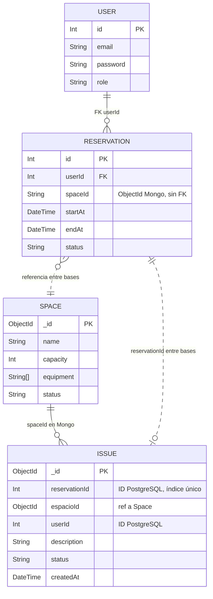
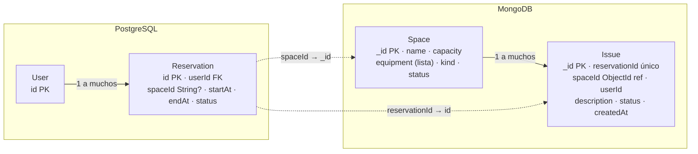

# Tarea individual U2 · Coworking

**Estudiante:** Jardel Maza · **N.º de lista:** 9 · **Caso:** 9 · Coworking

## 1. Workload

### 1.1 Casos de uso
- El cliente consulta espacios por capacidad, equipamiento y disponibilidad horaria.
- El cliente crea, consulta y cancela sus reservas.
- El cliente reporta una incidencia asociada a una reserva.
- El administrador mantiene el catálogo de espacios y atiende incidencias.

### 1.2 Datos principales
- Usuarios: estimación inicial de 500 clientes y 5 administradores; aumentan alrededor de 30 clientes al mes.
- Espacios: 40 al inicio; el catálogo cambia algunas veces al mes.
- Reservas: estimación de 80 por día; se conservan 3 años por historial y auditoría.
- Incidencias: estimación de 5 por día; crecen con el uso y se conservan 3 años.
- Horas se almacenan en UTC; la interfaz muestra la zona horaria local del espacio.

### 1.3 Suposiciones
- Una reserva pertenece a un usuario y referencia un espacio por su ObjectId de MongoDB.
- `inicio < fin`; dos reservas activas del mismo espacio no pueden solaparse. Intervalos que solo se tocan en el límite son válidos.
- Las reservas se crean en PostgreSQL dentro de una transacción y los solapamientos se serializan mediante un bloqueo advisory por ID de espacio, seguido de consulta de solapamiento.
- Una incidencia se asocia a una reserva existente del usuario autenticado. No hay más de una incidencia por reserva; índice único en MongoDB.
- El catálogo cambia poco y se consulta mucho. Equipamiento se guarda como arreglo de valores controlados.
- Si MongoDB no está disponible, el servidor no inicia. Una falla entre escrituras no se oculta: la operación incompleta devuelve error y queda registrada para reconciliación; no existe transacción distribuida entre motores.

### 1.4 Operaciones

| Actor | Operación | Tipo | Datos | Frecuencia / tasa estimada | Base y motivo |
|---|---|---|---|---|---|
| Cliente | Buscar espacios disponibles | Lectura | rango horario, capacidad, equipamiento | Muy alta; 500/día | MongoDB catálogo + PostgreSQL reservas para excluir cruces |
| Cliente | Ver detalle del espacio | Lectura | espacioId | Alta; 300/día | MongoDB; lectura directa de catálogo |
| Cliente | Crear reserva | Escritura | userId, espacioId, inicio, fin | Alta; 80/día | Ambas: comprobar espacio y guardar reserva con integridad transaccional |
| Cliente | Consultar sus reservas | Lectura | userId, rango de fechas | Alta; 200/día | PostgreSQL y catálogo MongoDB unido por `$in` |
| Cliente | Cancelar reserva | Escritura | reservaId, userId | Media; 15/día | PostgreSQL; autorización e integridad |
| Cliente | Reportar incidencia | Escritura | reservaId, descripción, categoría | Media; 5/día | Ambas: validar reserva/propietario y guardar registro creciente |
| Administrador | Crear o editar espacio | Escritura | nombre, capacidad, equipamiento, estado | Baja; 2/día | MongoDB; esquema flexible de catálogo |
| Administrador | Revisar incidencias | Lectura | estado, espacio, fecha | Media; 20/día | MongoDB con populate, orden y agregación |

### 1.5 Entidades
- **PostgreSQL:** `User`, `Reserva`.
- **MongoDB:** `Espacio` (catálogo), `Incidencia` (registro de crecimiento).
- **Entre bases (sin FK):** `Reservation.spaceId` contiene el ObjectId de `Space`; `Issue.reservationId` contiene el ID entero de `Reservation`; `Issue.espacioId` contiene el ObjectId de `Space`.

### 1.6 Observaciones
Predominan lecturas del catálogo y disponibilidad. Las incidencias crecen continuamente. Las reservas requieren integridad fuerte y prevención de solapamientos. La unión entre motores se hace en el servicio, no con una FK distribuida.

## 2. ¿PostgreSQL o MongoDB?

| Entidad | ¿Transacciones o choques? | ¿Otras dependen por FK? | ¿Forma variable? | ¿Crece sin límite? | ¿Se lee mucho más? | Base |
|---|---|---|---|---|---|---|
| User | Sí, identidad y permisos | Reserva tiene FK | No | Moderado | Sí | PostgreSQL |
| Reserva | Sí; evita horarios solapados | Incidencia referencia su ID lógico | No | Sí, con retención | Lecturas y escrituras | PostgreSQL |
| Espacio | No requiere transacción multi-registro | Reserva apunta por ObjectId | Sí, equipamiento/metadatos | No, catálogo acotado | Sí | MongoDB |
| Incidencia | No necesita transacción SQL | Referencia reserva y espacio validada por servicio | Sí, detalles y evidencias pueden variar | Sí | Sí, para administración | MongoDB |

## 3. Relaciones dentro de MongoDB: embeber o referenciar

| Relación | Cardinalidad | ¿Lectura conjunta frecuente? | ¿Se escribe junto? | ¿Consulta junto o por partes? | Decisión |
|---|---|---|---|---|---|
| Espacio → equipamiento | 1 a muchos, lista pequeña | Sí, junto con el espacio | Sí, al actualizar el espacio | Junto al espacio | Embeber como `String[]` |
| Espacio → incidencias | 1 a muchos | No siempre; el catálogo se consulta sin incidencias | No; se reportan después | Por partes, filtradas por espacio/estado | Referenciar `espacioId`, colección separada |
| Incidencia → reserva | Muchos a uno | Se consulta la reserva para validar | No; la incidencia se escribe después de la reserva | Por partes, la reserva solo se obtiene cuando hace falta | Guardar `reservaId` como referencia lógica a PostgreSQL |

## 4. ERD híbrido

**Zonas:** PostgreSQL: `User`, `Reserva`. MongoDB: `Espacio`, `Incidencia`. Las líneas punteadas representan referencias entre bases sin FK.

## 5. Referencias

| Referencia | Se guarda como | La garantiza | Se une con |
|---|---|---|---|
| Reservation → Space | `Reservation.spaceId` como String con ObjectId | Servicio valida `isValidObjectId` y `Space.exists()` antes de crear | Leer reservas, buscar espacios mediante `$in`, indexarlos en un `Map` |
| Issue → Reservation | `Issue.reservationId` como entero, índice único | Servicio consulta Prisma; 404 si no existe, 403 si el dueño no coincide | Consulta Prisma por los IDs distintos del listado |
| Issue → Space | `Issue.espacioId` como ObjectId | Servicio deriva el ID de la reserva ya validada y comprueba el espacio | `populate('espacioId')` en la consulta de incidencias |
| Reservation → User | `Reservation.userId` FK entera | PostgreSQL y middleware JWT | Prisma relation `user` |

## 6. Dato copiado entre bases (desnormalización)
- **Dato:** `userId` y `espacioId` en `Issue`; `spaceName` como instantánea al reportarla.
- **Por qué:** filtrar incidencias por usuario/espacio sin una consulta PostgreSQL por documento y conservar el contexto histórico.
- **Costo:** si cambia el nombre del espacio, la instantánea conserva el valor anterior; al borrar una reserva se debe decidir política de retención/reconciliación.

## 7. Endpoints

| Método y ruta | Base(s) | Respuestas posibles |
|---|---|---|
| POST `/api/auth/login` | PostgreSQL | 200, 401 |
| GET `/api/espacios?q=&fields=` | MongoDB | 200, 400 |
| GET `/api/espacios/:id` | MongoDB | 200, 400, 404 |
| POST `/api/espacios` | MongoDB | 201, 400, 401 |
| PUT `/api/espacios/:id` | MongoDB | 200, 400, 404, 401 |
| DELETE `/api/espacios/:id` | PostgreSQL + MongoDB | 204, 400, 401, 404, 409 |
| POST `/api/reservas` | PostgreSQL + MongoDB | 201, 400, 401, 404, 409 |
| GET `/api/reservas/mias` | Ambas | 200, 401 |
| DELETE `/api/reservas/:id` | PostgreSQL | 204, 401, 404, 403 |
| POST `/api/incidencias` | Ambas | 201, 400, 401, 403, 404, 409 |
| GET `/api/incidencias` | MongoDB + PostgreSQL | 200, 401 |

## 8. Fallos parciales entre motores

No hay transacción distribuida. La creación de reserva primero verifica MongoDB y luego confirma PostgreSQL; si Mongo falla antes de escribir, no se crea la reserva. La creación de incidencia valida PostgreSQL antes de escribir MongoDB; si Mongo falla, no se confirma la incidencia y se devuelve 503. Las operaciones son idempotentes donde aplica y se registran para reintento. El inicio del servidor espera conexión MongoDB y termina si no conecta.
